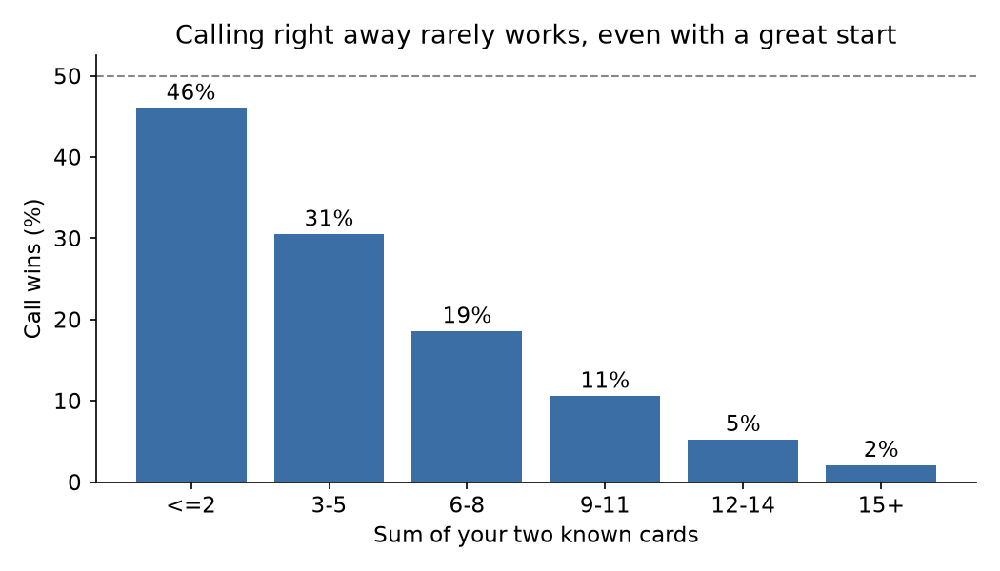
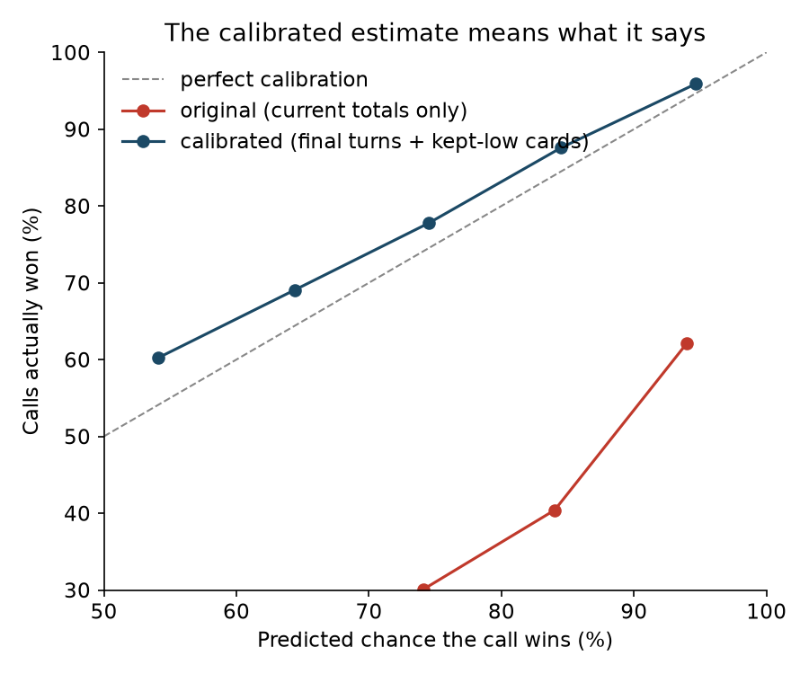
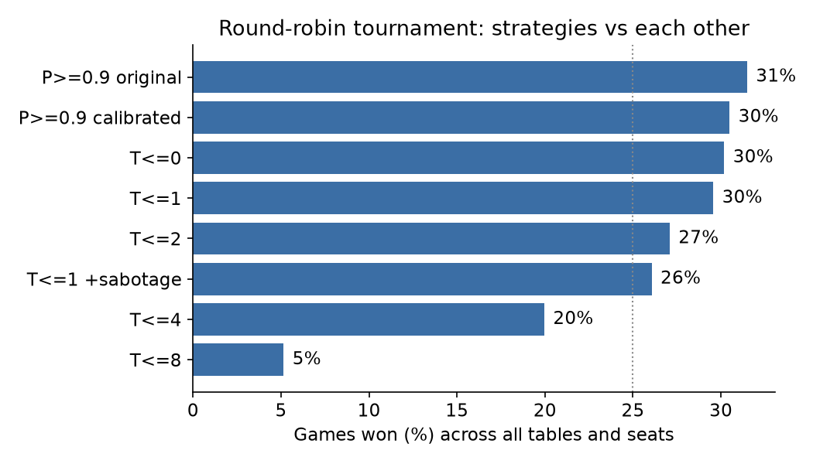

# KOMBIO Strategy Lab

A Monte Carlo simulator for the card game [KOMBIO](https://kombiocards.com), built to answer one question:
**is there a mathematical strategy that wins at least 70% of the time?**

I play KOMBIO a lot and believed two things: knowing two of my four cards lets me call early with
confidence, and tracking cards is what separates good players from bad ones. This project tests both
claims against tens of thousands of simulated four-player rounds.

## Key findings

| Question | Answer |
| --- | --- |
| Can you call right away with 2 known cards? | **No.** Even with the best start (known sum ≤ 2) the call wins only **46%** of the time. |
| What wins rounds? | **Patience.** Calling only when your estimated hand is ≤ 1 wins **86–92%** of calls. |
| Does memory matter? | **Yes, most of all.** The patient strategy (T ≤ 1) wins **45%** of games against perfect-memory opponents, **66%** against opponents who forget 15% of cards per turn and **80%** against 30% (random baseline: 25%). |
| Does "smart" probabilistic calling help? | **Only once it's calibrated.** The original estimate is badly overconfident: calls it rates 90%+ win only 62%. It ignored two things: every opponent gets a final turn, and opponents' hidden cards aren't random (they've been keeping low ones). Modeling both makes it honest: calls rated 90%+ now win **96%**, and P ≥ 0.9 wins **92–94%** of calls. |
| Does sabotage (11/12 dump on the leader) help? | **No measurable effect** (within noise). |
| What happens when patient strategies play *each other*? | **The edge disappears.** In a round-robin tournament the top four (calibrated and original P ≥ 0.9, T ≤ 0, T ≤ 1) all win **about 30%** of games, barely above the 25% baseline. T ≤ 8 wins 5%. Patience beats careless opponents; against other patient players nobody dominates. |
| Do memory *errors* matter, not just forgetting? | **Yes.** Opponents who misremember 10% of cards per turn make a wrong match every ~6 rounds, and T ≤ 1's game win rate rises from 65% to **75%**. Taking low cards (≤ 3) from the discard pile adds another **1.5–4 points**. |

**So: 70% call success is easy (any threshold ≤ 3). 70% of games requires playing patiently *and*
out-remembering your opponents.**








Full numbers: [`results/strategy_grid.csv`](results/strategy_grid.csv), [`results/early_call.csv`](results/early_call.csv),
[`results/calibration.csv`](results/calibration.csv), [`results/memory_errors.csv`](results/memory_errors.csv),
[`results/tournament.csv`](results/tournament.csv), [`results/tournament_head_to_head.csv`](results/tournament_head_to_head.csv).

## How the simulation works

**Deck (70 cards):** −1 ×3, 0 ×3, 1–12 ×5, 13 ×2, 14 ×2.

**Rules modeled** (official rulebook):

- 4 face-down cards each; every player peeks at 2.
- On a turn you draw from the deck (or take the top discard, which must be swapped in and has no ability),
  then swap it into your hand or discard it and use its ability:
  7/8 peek your own card · 9/10 peek an opponent's · 11/12 blind swap · 13 look at one card and swap ·
  14 look at two cards and swap.
- **Matching:** after any discard, anyone who knows a card of the same value (theirs or an opponent's)
  can throw it. Matching an opponent's card means giving them one of yours. A wrong match puts the card
  back face up for everyone to see and costs the thrower a penalty card.
- **Calling KOMBIO:** each opponent gets one final turn; the caller's hand is locked.
  Caller strictly lowest → everyone else +10. Otherwise → caller +15. 14-card bonuses included.

**How players think:**

- *Card counting:* an unknown card is valued at the average of all cards the player hasn't seen yet.
- *Calling rule:* call when `known cards + unknown cards × unseen average ≤ T`.
- *Memory:* each turn a player forgets each remembered card with probability `forget`, or remembers it
  as a wrong value (off by 1–2) with probability `misremember`. Wrong memories cause wrong matches.
- *Probabilistic calling:* Monte Carlo estimate of P(I end up strictly lowest). The calibrated version
  also plays out every opponent's final turn and treats their hidden cards as the lower of two random
  cards.
- Card knowledge follows a card when it is swapped (swaps happen in the open).

**Simplifications:** no bluffing. In experiments B–D the opponents are bots with a fixed threshold of 8;
experiment E (tournament) plays strategies against each other, rotating seats so nobody always moves first.
The discard-pile and wrong-match rules follow my reading of the rulebook; the penalty size is one constant
(`WRONG_MATCH_PENALTY_CARDS` in `cards.py`).

## Run it

Pure Python 3.10+, no dependencies (matplotlib only for charts).

```bash
python scripts/run_experiments.py           # full run, ~7 minutes on 2 cores
python scripts/run_experiments.py --quick   # smoke test
python -m pytest tests                      # rule tests
```

Use it as a library:

```python
import random
from kombio import Strategy, play_game

me = Strategy(threshold=1)                       # the patient caller
opponents = [Strategy(threshold=8, forget=0.15)] * 3
scores = play_game([me, *opponents], random.Random(42))
print(scores)  # cumulative scores, lowest wins
```

## Project layout

```
kombio/
  cards.py        deck, scoring, calling bonus/penalty
  engine.py       one round / one game between strategy-driven players
  strategies.py   Strategy parameters (threshold, memory, probabilistic calling, sabotage, discard pile)
  experiments.py  experiments behind the results above (early call, grid, calibration, memory errors, tournament)
scripts/run_experiments.py   reproduces every table and chart
tests/test_rules.py          deck, scoring and engine invariants
```

## What I'd do next

- **Evolve strategies:** let the tournament's winners reproduce (replicator dynamics) to see which mix is stable.
- **Exploit the calibrated estimate:** call when P(win) × 10 beats the expected cost of waiting, instead of a fixed 90%.
- **Learn a policy:** train a reinforcement-learning agent on the same engine and compare it with the hand-written rules.

## License

MIT
