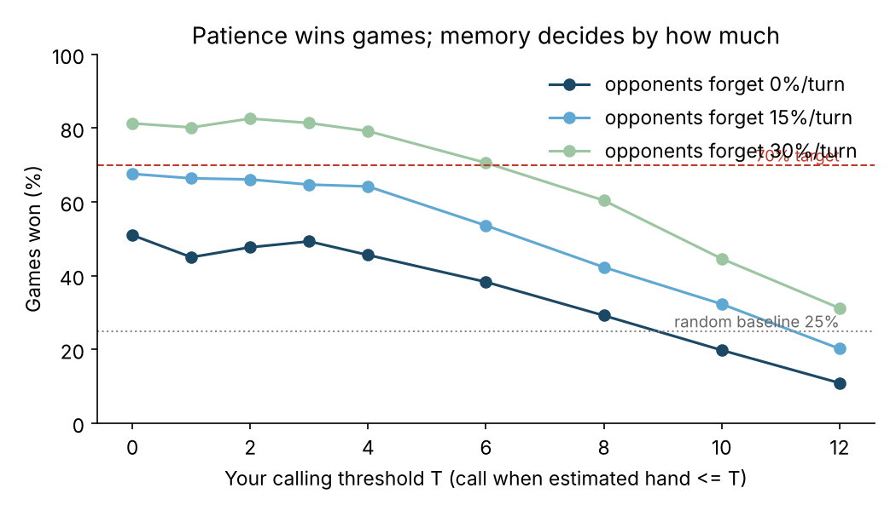

# KOMBIO Strategy Lab

A Monte Carlo simulator for the card game [KOMBIO](https://kombiocards.com), built to answer one question:
**is there a mathematical strategy that wins at least 70% of the time?**

I play KOMBIO a lot and believed two things: knowing two of my four cards lets me call early with
confidence, and tracking cards is what separates good players from bad ones. This project tests both
claims against tens of thousands of simulated four-player rounds.

## Key findings

| Question | Answer |
| --- | --- |
| Can you call right away with 2 known cards? | **No.** Even with the best start (known sum ≤ 2) the call wins only **46%** of the time. |
| What wins rounds? | **Patience.** Calling only when your estimated hand is ≤ 1 wins **86–92%** of calls. |
| Does memory matter? | **Yes, most of all.** The patient strategy (T ≤ 1) wins **45%** of games against perfect-memory opponents, **66%** against opponents who forget 15% of cards per turn and **80%** against 30% (random baseline: 25%). |
| Does "smart" probabilistic calling help? | **Not as written.** Calling when the estimated P(lowest) ≥ 90% actually wins only 63–76% of calls: the estimate ignores the final turn every opponent gets, so it is overconfident. |
| Does sabotage (11/12 dump on the leader) help? | **No measurable effect** (within noise). |

**So: 70% call success is easy (any threshold ≤ 3). 70% of games requires playing patiently *and*
out-remembering your opponents.**




Full numbers: [`results/strategy_grid.csv`](results/strategy_grid.csv), [`results/early_call.csv`](results/early_call.csv).

## How the simulation works

**Deck (70 cards):** −1 ×3, 0 ×3, 1–12 ×5, 13 ×2, 14 ×2.

**Rules modeled** (official rulebook):

- 4 face-down cards each; every player peeks at 2.
- On a turn you draw from the deck, then swap it into your hand or discard it and use its ability:
  7/8 peek your own card · 9/10 peek an opponent's · 11/12 blind swap · 13 look at one card and swap ·
  14 look at two cards and swap.
- **Matching:** after any discard, anyone who knows a card of the same value (theirs or an opponent's)
  can throw it. Matching an opponent's card means giving them one of yours.
- **Calling KOMBIO:** each opponent gets one final turn; the caller's hand is locked.
  Caller strictly lowest → everyone else +10. Otherwise → caller +15. 14-card bonuses included.

**How players think:**

- *Card counting:* an unknown card is valued at the average of all cards the player hasn't seen yet.
- *Calling rule:* call when `known cards + unknown cards × unseen average ≤ T`.
- *Memory:* each turn a player forgets each remembered card with probability `forget`.
- Card knowledge follows a card when it is swapped (swaps happen in the open).

**Simplifications:** no drawing from the discard pile, no bluffing, and players only act on cards they
remember, so wrong-match penalties never happen. Opponents are bots with a fixed threshold of 8.

## Run it

Pure Python 3.10+, no dependencies (matplotlib only for charts).

```bash
python scripts/run_experiments.py           # full run, ~1 minute on 2 cores
python scripts/run_experiments.py --quick   # smoke test
python -m pytest tests                      # rule tests
```

Use it as a library:

```python
import random
from kombio import Strategy, play_game

me = Strategy(threshold=1)                       # the patient caller
opponents = [Strategy(threshold=8, forget=0.15)] * 3
scores = play_game([me, *opponents], random.Random(42))
print(scores)  # cumulative scores, lowest wins
```

## Project layout

```
kombio/
  cards.py        deck, scoring, calling bonus/penalty
  engine.py       one round / one game between strategy-driven players
  strategies.py   Strategy parameters (threshold, memory, probabilistic calling, sabotage)
  experiments.py  experiments behind the results above
scripts/run_experiments.py   reproduces every table and chart
tests/test_rules.py          deck, scoring and engine invariants
```

## What I'd do next

- **Calibrate the probabilistic caller:** simulate each opponent's final turn inside the estimate.
- Add drawing from the discard pile and wrong-match penalties for forgetful players.
- Let strategies play each other in a tournament instead of against fixed bots.

## License

MIT
